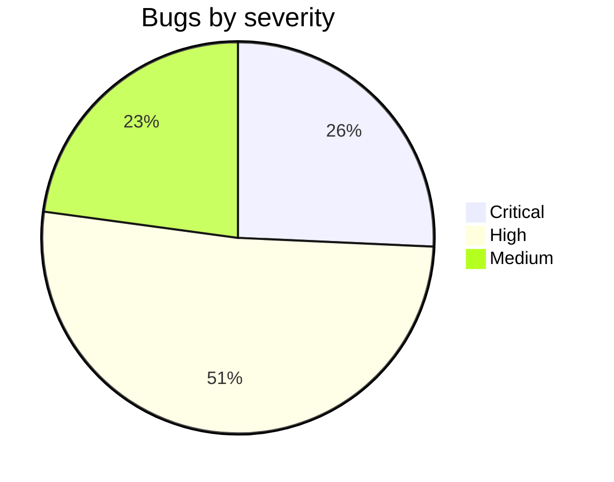
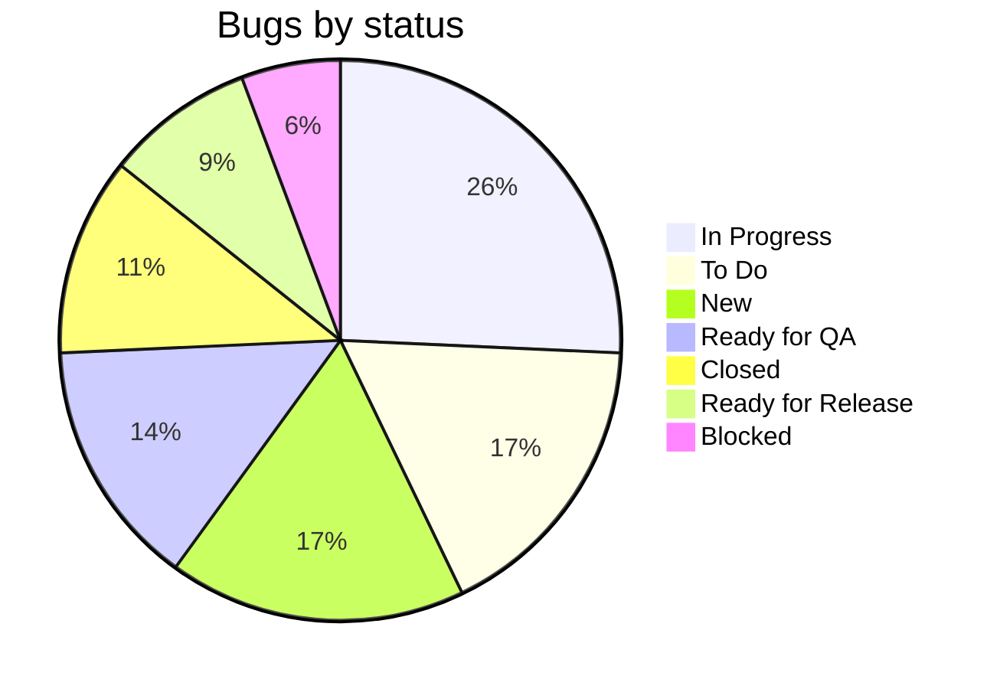
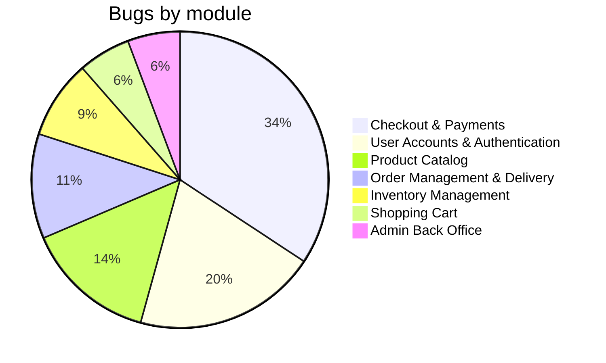
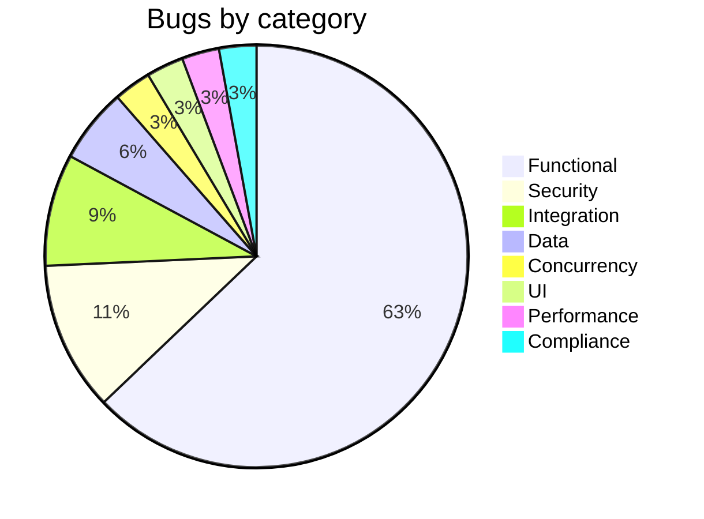
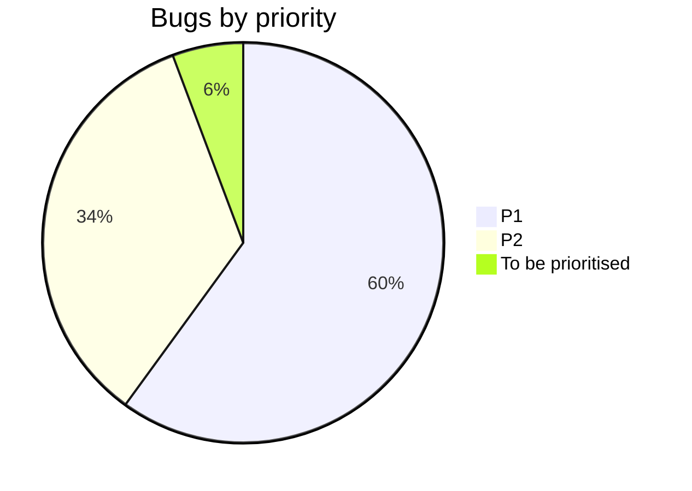

📊 Bug Trend Analysis Report

## Overview

### High Bug Trend Modules

| Module | Bug Count | Critical Count | Automation Gap |
|---|---|---|---|
| **Checkout & Payments** | 12 | 6 | Stripe webhook delays, retries and invalid signatures; double-click and idempotency; coupon rules and date boundaries (BF2026); price tampering; iOS Safari / mobile checkout. |
| **User Accounts & Authentication** | 7 | 0 | Login lockout and rate limiting; token refresh and session expiry; verification link expiry; email case uniqueness; cookie consent; address data migration checks. |
| **Product Catalog** | 5 | 0 | Filter correctness (OS, compatibility, out-of-stock); old-URL 301 redirects; price with taxes consistency; image size and LCP budget. |
| Order Management & Delivery | 4 | 2 | Authorization (IDOR) on order details; Stripe refund on cancellation (sandbox unstable); 30-day return boundary; email template content. |
| Inventory Management | 3 | 1 | Concurrent last-unit purchase; stock release after failed payment and cancellation. |
| Shopping Cart | 2 | 0 | Totals refresh after quantity change; cart data migration across releases. |
| Admin Back Office | 2 | 0 | Little automation overall; order status transitions and product visibility (Hidden until published). |
| **Total** | **35** | **9** | |

Top 3 high-density areas (bold): 24 of 35 bugs (68.6%).

### Bug Metrics Summary

| Metric | Value |
|---|---|
| Total bugs | 35 |
| Critical bugs | 9 (High 18, Medium 8, Low 0) |
| P1 bugs | 21 (P2 12, To be prioritised 2) |
| Closed bugs | 4 (BUG-001, 002, 003, 008) |
| Average resolution time | 8 days (closed bugs only: 8 + 5 + 8 + 11 = 32 days / 4) |
| Open bugs | 31 |

#### Severity distribution

#### Bugs by status

| Status | Bugs | Count |
|---|---|---|
| In Progress | 004, 007, 009, 010, 014, 026, 027, 030, 033 | 9 |
| To Do | 005, 006, 012, 016, 018, 031 | 6 |
| New | 021, 022, 023, 024, 025, 032 | 6 |
| Ready for QA | 011, 013, 019, 028, 034 | 5 |
| Closed | 001, 002, 003, 008 | 4 |
| Ready for Release | 015, 017, 029 | 3 |
| Blocked | 020, 035 | 2 |
| **Total** | | **35** |

### Automation Candidates Table

Bugs that could have been caught by automated tests: 33 of 35 (API 19, Unit 8, UI 6).

| # | Bug ID | Title | Component | Type of Automation | Suggested Test Case |
|---|---|---|---|---|---|
| 1 | BUG-001 | User cannot login after password reset | Password reset and login | API | Lock the account with 3 wrong logins, reset the password, then log in with the new one and expect 200. |
| 2 | BUG-002 | OS filter Android shows iOS devices | Catalog filters (OS) | API | Call the catalog with `os=Android` and assert every item has OS = Android. |
| 3 | BUG-003 | Coupon "10PERCENTFIRSTORDER" not working | Coupon calculation | Unit | A first order with the coupon reduces the total by 10%. |
| 4 | BUG-004 | BF2026 discounts both units | Coupon calculation (BF2026) | Unit | With 2 units at 1000.00, assert the discount is 200.00 and the total is 1800.00. |
| 5 | BUG-005 | BF2026 applied without a valid token | Coupon API, auth guard | API | POST `/api/checkout/coupon` with no or an expired token returns 401 and no discount. |
| 6 | BUG-006 | BF2026 accepted after promotion end | Coupon validity period | Unit | Run the validator at 2026-11-30 23:59:59 and 2026-12-01 00:00:00 (Europe/Bucharest). The first is accepted, the second rejected. |
| 7 | BUG-007 | No redemption record for BF2026 | Coupon redemption records | API | After a paid order with BF2026, assert the record exists and a second use is rejected. |
| 8 | BUG-008 | Cart total not updated after quantity change | Cart totals display | UI | In Playwright, change the quantity from 1 to 3 and assert the line and cart totals show 3000.00 without a reload. |
| 9 | BUG-009 | Overselling of the last unit | Stock reservation | API | Send 2 parallel checkouts for stock = 1 (k6 or Jest). Expect one success, one out-of-stock, and stock = 0. |
| 10 | BUG-010 | Order stays Pending after Stripe payment | Stripe webhook handler | API | Send a signed `payment_intent.succeeded` event and assert the order becomes Paid, the email is sent, the stock is deducted, and the response is under the timeout. |
| 11 | BUG-011 | Double click on "Pay now" creates 2 orders | Pay now button, order creation | UI | Double-click "Pay now" in Playwright and assert 1 order is created and the button is disabled. |
| 12 | BUG-012 | Case filter shows Samsung and out-of-stock items | Catalog filters (compatibility) | API | Filter by `compatibility=iPhone 16` and assert only compatible items are returned, with out-of-stock items hidden or flagged. |
| 13 | BUG-013 | Order details of another customer visible (IDOR) | Order details endpoint | API | Customer B calls `GET /api/orders/{A's id}` and expects 403 or 404 with no data. |
| 14 | BUG-014 | Stock not released after failed payment | Stock reservation release | API | Pay with the declined card 4000 0000 0000 0002 and assert stock returns to 1. |
| 15 | BUG-015 | Return accepted 31 days after delivery | Return eligibility check | Unit | Boundary test at day 29, 30 and 31. Day 31 is rejected. |
| 16 | BUG-016 | Address with diacritics rejected | Delivery address validation | Unit | Validate "Șoseaua Pantelimon 245" and the city "Iași" as valid. |
| 17 | BUG-017 | Order created with a modified client price | Checkout API, price calculation | API | POST `/api/checkout` with `unitPrice=1.00`. The total is the catalog price or the response is 400. |
| 18 | BUG-018 | Account not locked after failed logins | Login rate limiting and lockout | API | Send 6 wrong logins. Expect 429 or a lock, and the correct password is rejected. |
| 19 | BUG-019 | Unverified email can checkout | Checkout eligibility check | API | Checkout with an unverified user is blocked with an error. |
| 20 | BUG-020 | Cancelled order not refunded | Order cancellation, Stripe refund | API | Cancel a paid order with the Stripe mock and assert the refund call, the status and the email. |
| 21 | BUG-021 | Expired verification link still verifies | Email verification link | Unit | The token is rejected at 24 h 1 min and the account stays Unverified. |
| 22 | BUG-022 | Email uniqueness is case sensitive | Sign up, email uniqueness | API | Register `john@example.com`, then `John@Example.com`. The second is rejected. |
| 23 | BUG-023 | Cancel does not return units to stock | Order cancellation, stock release | API | Buy 2 of 5, cancel, and assert stock = 5. |
| 24 | BUG-024 | Delivered order set back to Processing | Back office status transitions | API | PATCH Delivered to Processing is rejected and the status is unchanged. |
| 25 | BUG-025 | New product visible before publishing | Product creation, visibility | API | Create a product and assert it is Hidden and absent from the catalog, search and direct URL. |
| 26 | BUG-026 | "Pay now" not clickable on iPhone Safari | Checkout page layout | UI | Playwright WebKit with the iPhone 15 viewport. Scroll down and click "Pay now". |
| 27 | BUG-027 | Old product URLs return 404 | URL routing and redirects | API | Request `/product/101` and expect 301 to the new URL, with a list of old URLs. |
| 28 | BUG-028 | Carts empty after release | Cart data migration | API | Seed pre-release carts, run the migration, and assert `GET /cart` returns the items. |
| 29 | BUG-029 | Session lost, token not refreshed | Token refresh in the API client | UI | After the access token expires, assert `/auth/refresh` returns 200 with the cookie and the user stays logged in. |
| 30 | BUG-031 | Confirmation email has old logo, broken links, no total | Order confirmation email template | Unit | Render the template with a sample order and assert the total, address, logo and "View order" link. |
| 31 | BUG-032 | Cookie banner on every load, scripts run before consent | Cookie consent banner | UI | Assert no analytics requests before consent. After "Reject all", assert the banner stays hidden and no requests are sent. |
| 32 | BUG-033 | Saved addresses missing phone after migration | Delivery address data migration | Unit | Run the migration on sample rows and assert `contact_phone` equals the old `phone`. |
| 33 | BUG-034 | Product card price shown without taxes | Product card price | UI | Compare the card, product page and checkout price (48.00 EUR). |
| | **Total** | **33** | | API 19, Unit 8, UI 6 | |

Not included: BUG-030 (performance budget, needs Lighthouse CI) and BUG-035 (Production secret, only a post-deploy smoke test would catch it).

### Test Cases to Create

High-level test cases that would have detected each bug earlier (one per bug, 35 in total).

| TC ID | Bug ID | Test Case Title | Steps |
|---|---|---|---|
| TC-01 | BUG-001 | Login works with the new password after a reset | 1. Enter a wrong password 3 times. 2. Reset the password via "Forgot password". 3. Log in with the new password. 4. Verify the login succeeds and the failed-attempt counter is cleared. |
| TC-02 | BUG-002 | OS filter returns only matching devices | 1. Open Products and filter Smartphones by OS = Android. 2. Check every listed item. 3. Verify no iOS device is shown. Repeat for OS = iOS. |
| TC-03 | BUG-003 | First-order coupon reduces the total | 1. Create a new account. 2. Add a smartphone to the cart. 3. Apply "10PERCENTFIRSTORDER" at Checkout. 4. Verify the total is reduced by 10%. |
| TC-04 | BUG-004 | BF2026 discounts only one unit | 1. Log in as a registered user during the promotion. 2. Add 2 units at 1000.00 each. 3. Apply "BF2026". 4. Verify the discount is 200.00 and the total is 1800.00. |
| TC-05 | BUG-005 | Coupon API rejects missing or expired tokens | 1. Send POST `/api/checkout/coupon` with no Authorization header. 2. Repeat with an expired token. 3. Verify the response is 401 and no discount is applied. |
| TC-06 | BUG-006 | BF2026 validity boundaries | 1. Set the time to 2026-11-30 23:59:59 and apply the coupon. 2. Set the time to 2026-12-01 00:00:00 and apply it. 3. Verify the first is accepted and the second rejected. |
| TC-07 | BUG-007 | Redemption is stored and the limit enforced | 1. Complete an order with "BF2026". 2. Check the redemption record (user, product, quantity, amount, UTC timestamp). 3. Apply "BF2026" again for the same product. 4. Verify it is rejected. |
| TC-08 | BUG-008 | Cart totals update after a quantity change | 1. Add 1 unit at 1000.00 to the cart. 2. Change the quantity to 3 on the Cart page. 3. Verify the line and cart totals show 3000.00 without a reload. |
| TC-09 | BUG-009 | Last unit cannot be oversold | 1. Set stock = 1. 2. Start the checkout for 2 customers at the same time. 3. Verify only 1 order is completed. 4. Verify the second customer gets an out-of-stock message and is not charged. 5. Verify stock = 0. |
| TC-10 | BUG-010 | Payment webhook updates the order within the timeout | 1. Pay with a Stripe test card. 2. Send the signed `payment_intent.succeeded` event. 3. Verify the response is 200 within the timeout. 4. Verify the order is Paid, the email is sent and the stock is deducted. |
| TC-11 | BUG-011 | Double click on "Pay now" creates one order | 1. Open Checkout with a valid card. 2. Double-click "Pay now". 3. Verify 1 order and 1 charge. 4. Verify the button is disabled after the first click. |
| TC-12 | BUG-012 | Compatibility filter shows only compatible, available cases | 1. Open Phone cases. 2. Filter by "Apple iPhone 16". 3. Verify no Samsung cases appear. 4. Verify out-of-stock items are hidden or clearly flagged. |
| TC-13 | BUG-013 | Customer cannot view another customer's order | 1. Log in as Customer B. 2. Open Customer A's order URL and API endpoint. 3. Verify 403 or 404 and no personal data. |
| TC-14 | BUG-014 | Stock is released after a declined payment | 1. Set stock = 1. 2. Pay with the declined card 4000 0000 0000 0002. 3. Verify stock returns to 1 (or after the 15-minute timeout). 4. Verify another customer can buy the product. |
| TC-15 | BUG-015 | 30-day return window boundaries | 1. Request a return for orders delivered 29, 30 and 31 days ago. 2. Verify 29 and 30 are accepted. 3. Verify 31 is rejected with the expiry message. |
| TC-16 | BUG-016 | Address with Romanian diacritics is accepted | 1. Open "Add new address". 2. Enter Ștefan Țurcanu, Șoseaua Pantelimon 245, București. 3. Save. 4. Verify the address is saved and the customer can continue. |
| TC-17 | BUG-017 | Server ignores the client price | 1. Intercept POST `/api/checkout`. 2. Change `unitPrice` from 1000.00 to 1.00. 3. Send the request. 4. Verify the total is 1000.00 or the response is 400. |
| TC-18 | BUG-018 | Account lockout after failed logins | 1. Send 5 wrong passwords for one account. 2. Verify the lockout or 429 message. 3. Send the correct password. 4. Verify it is rejected until the lockout expires. |
| TC-19 | BUG-019 | Unverified email cannot checkout | 1. Register and do not verify the email. 2. Add a product and open Checkout. 3. Try to pay. 4. Verify payment is blocked with a "Resend verification email" option. |
| TC-20 | BUG-020 | Cancelled order is refunded | 1. Pay for an order. 2. Cancel it before shipment. 3. Verify the Stripe refund is created. 4. Verify the status and the cancellation and refund email. |
| TC-21 | BUG-021 | Verification link expires after 24 hours | 1. Register an account. 2. Move the time forward 24 h 1 min. 3. Open the link. 4. Verify "This link has expired", the account stays Unverified and a resend option is shown. |
| TC-22 | BUG-022 | Email uniqueness is case insensitive | 1. Register `john@example.com`. 2. Register `John@Example.com`. 3. Verify it is rejected and no second account exists. |
| TC-23 | BUG-023 | Cancelled order restores stock | 1. Set stock = 5. 2. Buy 2 units (stock = 3). 3. Cancel the order. 4. Verify stock = 5. |
| TC-24 | BUG-024 | Invalid order status transition is rejected | 1. As Support Agent, open a Delivered order. 2. Change the status to Processing in the UI and via PATCH. 3. Verify the change is rejected, the status stays Delivered and no notification is sent. |
| TC-25 | BUG-025 | New product is Hidden until published | 1. As Catalog Manager, create and save a product without publishing. 2. As a visitor, search for it and open its URL. 3. Verify the status is Hidden and it is not visible. |
| TC-26 | BUG-026 | "Pay now" is clickable on iOS Safari | 1. Open Checkout on iPhone 15 Safari (or WebKit mobile emulation). 2. Scroll to the bottom. 3. Tap "Pay now". 4. Verify the button is not covered by the sticky summary and the payment starts. |
| TC-27 | BUG-027 | Old product URLs redirect | 1. Request `/product/101` and a sample of old URLs. 2. Verify a 301 response to `/products/[brand]/[slug]-101`. 3. Verify the product page loads. |
| TC-28 | BUG-028 | Pre-release carts survive the migration | 1. Seed carts in the old format. 2. Run the migration or deploy. 3. Log in and open the Cart. 4. Verify all items, prices and availability are shown. |
| TC-29 | BUG-029 | Session refreshes silently | 1. Log in with "Remember me". 2. Wait until the access token expires (5 min). 3. Open the Cart. 4. Verify `/auth/refresh` returns 200 with the cookie and the user stays logged in. |
| TC-30 | BUG-030 | Catalog image weight and LCP budget | 1. Open the catalog on Fast 4G throttling. 2. Check the image sizes and LCP in Lighthouse. 3. Verify images are optimized (under 200 KB) and LCP is under 2.5 s. |
| TC-31 | BUG-031 | Order confirmation email content | 1. Place an order. 2. Open the email. 3. Verify the new logo, order number, items, total with taxes and delivery address. 4. Click "View order" and verify the page opens. |
| TC-32 | BUG-032 | Cookie consent is respected and saved | 1. Open the site in a private window and check the network requests. 2. Verify no analytics or marketing requests before consent. 3. Click "Reject all" and navigate. 4. Verify the banner stays hidden and no tracking requests are sent. |
| TC-33 | BUG-033 | Address phone numbers are preserved by the migration | 1. Run the migration on sample addresses with phone numbers. 2. Compare `phone` and `contact_phone`. 3. Open a saved address and Checkout. 4. Verify the phone is pre-filled. |
| TC-34 | BUG-034 | Price with taxes is consistent everywhere | 1. Note the price on the product card, product page, cart and Checkout. 2. Verify all show the same price with taxes (48.00 EUR). |
| TC-35 | BUG-035 | Post-deploy webhook smoke test | 1. After the infrastructure deploy, place an order with the smoke test account. 2. Check the webhook delivery in Stripe. 3. Verify the response is 200 (no "Invalid signature"). 4. Verify the order is Paid and the email is sent. |
| | **Total** | **35 test cases** | |

### Risk-Based Prioritization Table

Risk Score = Critical x 3 + High x 2 + Medium x 1 (bugs of the module).

| Module | Risk Score | Recommended Action |
|---|---|---|
| Checkout & Payments | 29 (6x3 + 5x2 + 1) | Highest priority: add API and E2E tests for webhooks (retry, duplicate, invalid signature), idempotency, coupon and date boundaries, server-side price; run a mobile Safari check and post-deploy smoke test. |
| User Accounts & Authentication | 12 (5x2 + 2) | Add negative auth tests (lockout, expired token, refresh, verification expiry, email case); test the migration of addresses and the cookie consent. |
| Order Management & Delivery | 9 (2x3 + 1x2 + 1) | Add IDOR and authorization tests; test the Stripe refund on cancellation with mocks; test the 30-day boundary (day 29, 30, 31). |
| Product Catalog | 8 (3x2 + 2) | Add filter tests with edge-case data; check 301 redirects, price with taxes and the LCP budget in CI. |
| Inventory Management | 7 (1x3 + 2x2) | Add concurrency tests (k6, Jest) for the last unit and release on failed payment and cancellation. |
| Shopping Cart | 3 (1x2 + 1) | Add a UI test for totals after a quantity change; verify cart migration with pre-release data. |
| Admin Back Office | 3 (1x2 + 1) | Start automation for status transitions and product visibility. |

### Charts & Visuals

#### Bug Count by Module

| Module | Bugs | Count |
|---|---|---|
| Checkout & Payments | 003, 004, 005, 006, 007, 010, 011, 016, 017, 019, 026, 035 | 12 |
| User Accounts & Authentication | 001, 018, 021, 022, 029, 032, 033 | 7 |
| Product Catalog | 002, 012, 027, 030, 034 | 5 |
| Order Management & Delivery | 013, 015, 020, 031 | 4 |
| Inventory Management | 009, 014, 023 | 3 |
| Shopping Cart | 008, 028 | 2 |
| Admin Back Office | 024, 025 | 2 |
| **Total** | | **35** |

#### Bug Split by Category

Based on the Category column of the CSV.

| Category | Bugs | Count |
|---|---|---|
| Functional | 001, 002, 003, 004, 006, 007, 008, 011, 012, 014, 015, 016, 019, 021, 022, 023, 024, 025, 027, 029, 031, 034 | 22 |
| Security | 005, 013, 017, 018 | 4 |
| Integration | 010, 020, 035 | 3 |
| Data | 028, 033 | 2 |
| Concurrency | 009 | 1 |
| UI | 026 | 1 |
| Performance | 030 | 1 |
| Compliance | 032 | 1 |
| **Total** | | **35** |

Migration tag (separate flag, 11 bugs): 003, 026, 027, 028, 029, 030, 031, 032, 033, 034, 035.

#### Bug Count by Priority & Status

| Priority | In Progress | To Do | New | Ready for QA | Closed | Ready for Release | Blocked | Total |
|---|---|---|---|---|---|---|---|---|
| P1 | 8 | 2 | 1 | 5 | 1 | 2 | 2 | 21 |
| P2 | 1 | 3 | 4 | 0 | 3 | 1 | 0 | 12 |
| To be prioritised | 0 | 1 | 1 | 0 | 0 | 0 | 0 | 2 |
| **Total** | 9 | 6 | 6 | 5 | 4 | 3 | 2 | **35** |

