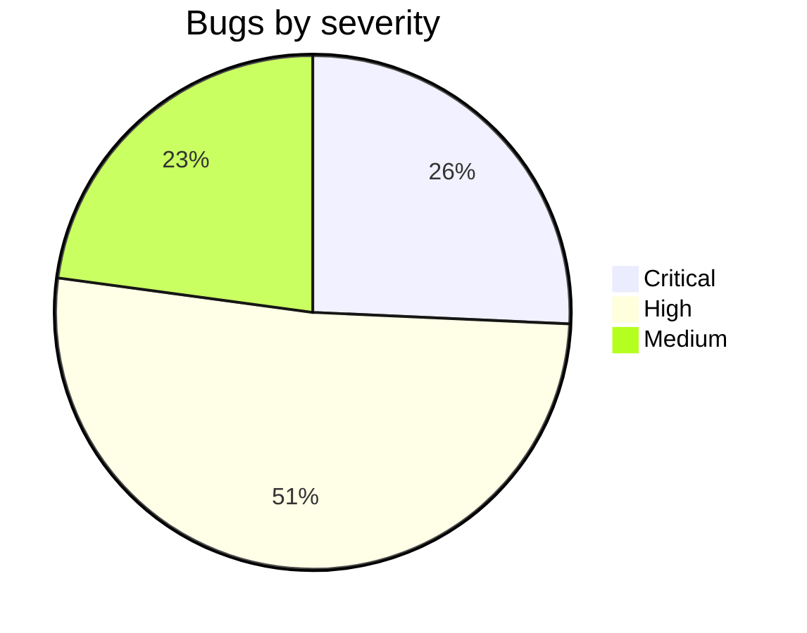
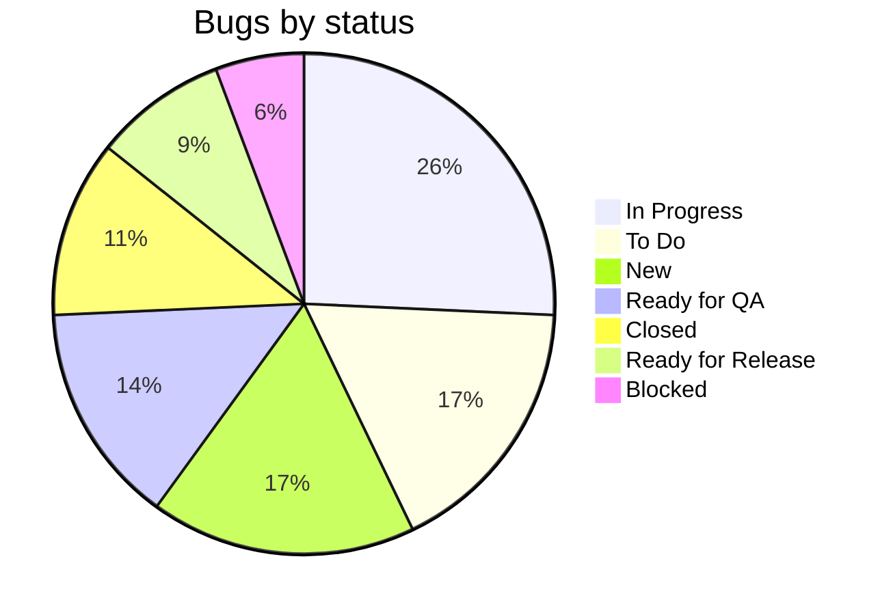
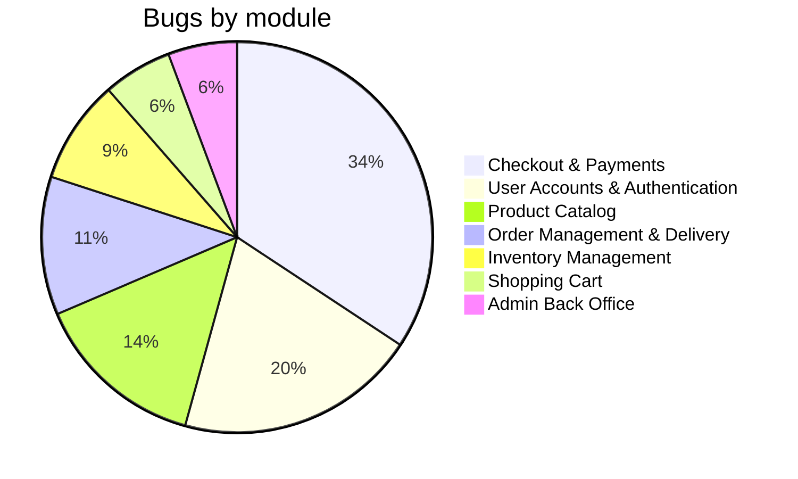
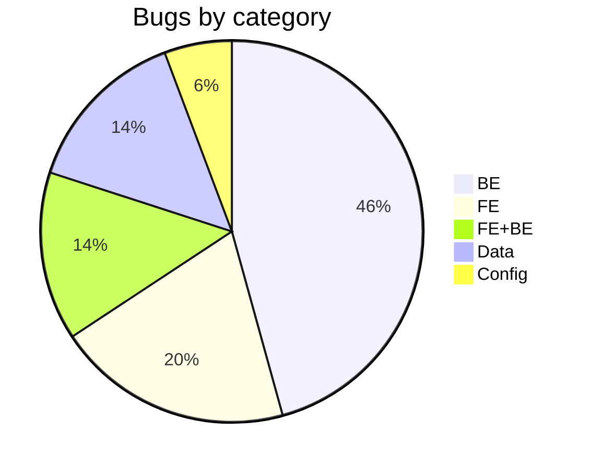

📊 Bug Trend Analysis Report

## Overview

### High Bug Trend Modules

| Module | Bug Count | Critical Count | Automation Gap |
|---|---|---|---|
| **Checkout & Payments** | 12 | 6 | Stripe webhook delays, retries and invalid signatures; double-click and idempotency; coupon rules and date boundaries (BF2026); price tampering; iOS Safari / mobile checkout. |
| **User Accounts & Authentication** | 7 | 0 | Login lockout and rate limiting; token refresh and session expiry; verification link expiry; email case uniqueness; cookie consent; address data migration checks. |
| **Product Catalog** | 5 | 0 | Filter correctness (OS, compatibility, out-of-stock); old-URL 301 redirects; price with taxes consistency; image size and LCP budget. |
| Order Management & Delivery | 4 | 2 | Authorization (IDOR) on order details; Stripe refund on cancellation (sandbox unstable); 30-day return boundary; email template content. |
| Inventory Management | 3 | 1 | Concurrent last-unit purchase; stock release after failed payment and cancellation. |
| Shopping Cart | 2 | 0 | Totals refresh after quantity change; cart data migration across releases. |
| Admin Back Office | 2 | 0 | Little automation overall; order status transitions and product visibility (Hidden until published). |
| **Total** | **35** | **9** | |

Top 3 high-density areas (bold): 24 of 35 bugs (68.6%).

### Bug Metrics Summary

| Metric | Value |
|---|---|
| Total bugs | 35 |
| Critical bugs | 9 (High 18, Medium 8, Low 0) |
| P1 bugs | 21 (P2 12, To be prioritised 2) |
| Closed bugs | 4 (BUG-001, 002, 003, 008) |
| Average resolution time | 8 days (closed bugs only: 8 + 5 + 8 + 11 = 32 days / 4) |
| Open bugs | 31 |

#### Severity distribution

#### Bugs by status

| Status | Bugs | Count |
|---|---|---|
| In Progress | 004, 007, 009, 010, 014, 026, 027, 030, 033 | 9 |
| To Do | 005, 006, 012, 016, 018, 031 | 6 |
| New | 021, 022, 023, 024, 025, 032 | 6 |
| Ready for QA | 011, 013, 019, 028, 034 | 5 |
| Closed | 001, 002, 003, 008 | 4 |
| Ready for Release | 015, 017, 029 | 3 |
| Blocked | 020, 035 | 2 |
| **Total** | | **35** |

### Automation Candidates Table

As per prompt in Use Case 5

### Test Cases to Create

Generated from past bugs/incidents (Use Case 6)

### Risk-Based Prioritization Table

Risk Score = Critical x 3 + High x 2 + Medium x 1 (bugs of the module).

| Module | Risk Score | Recommended Action |
|---|---|---|
| Checkout & Payments | 29 (6x3 + 5x2 + 1) | Highest priority: add API and E2E tests for webhooks (retry, duplicate, invalid signature), idempotency, coupon and date boundaries, server-side price; run a mobile Safari check and post-deploy smoke test. |
| User Accounts & Authentication | 12 (5x2 + 2) | Add negative auth tests (lockout, expired token, refresh, verification expiry, email case); test the migration of addresses and the cookie consent. |
| Order Management & Delivery | 9 (2x3 + 1x2 + 1) | Add IDOR and authorization tests; test the Stripe refund on cancellation with mocks; test the 30-day boundary (day 29, 30, 31). |
| Product Catalog | 8 (3x2 + 2) | Add filter tests with edge-case data; check 301 redirects, price with taxes and the LCP budget in CI. |
| Inventory Management | 7 (1x3 + 2x2) | Add concurrency tests (k6, Jest) for the last unit and release on failed payment and cancellation. |
| Shopping Cart | 3 (1x2 + 1) | Add a UI test for totals after a quantity change; verify cart migration with pre-release data. |
| Admin Back Office | 3 (1x2 + 1) | Start automation for status transitions and product visibility. |

### Charts & Visuals (optional)

#### Bug Count by Module

#### Bug Split by Category

| Category | Bugs | Count |
|---|---|---|
| BE | 001, 003, 004, 005, 006, 007, 009, 010, 014, 015, 017, 020, 021, 023, 024, 031 | 16 |
| FE | 008, 026, 027, 029, 030, 032, 034 | 7 |
| FE+BE | 011, 013, 016, 019, 025 | 5 |
| Data | 002, 012, 022, 028, 033 | 5 |
| Config | 018, 035 | 2 |
| **Total** | | **35** |

Migration tag (separate flag, 11 bugs): 003, 026, 027, 028, 029, 030, 031, 032, 033, 034, 035.

#### Bug Count by Priority & Status

| Priority | In Progress | To Do | New | Ready for QA | Closed | Ready for Release | Blocked | Total |
|---|---|---|---|---|---|---|---|---|
| P1 | 8 | 2 | 1 | 5 | 1 | 2 | 2 | 21 |
| P2 | 1 | 3 | 4 | 0 | 3 | 1 | 0 | 12 |
| To be prioritised | 0 | 1 | 1 | 0 | 0 | 0 | 0 | 2 |
| **Total** | 9 | 6 | 6 | 5 | 4 | 3 | 2 | **35** |

