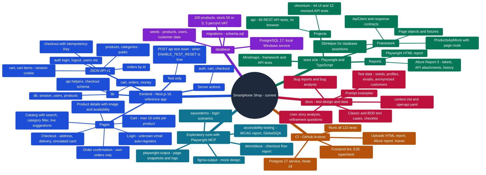
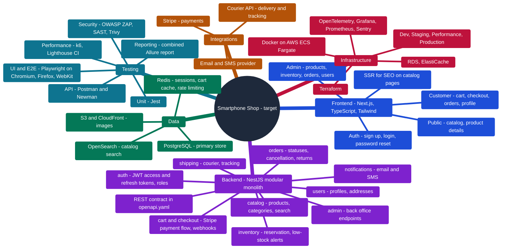
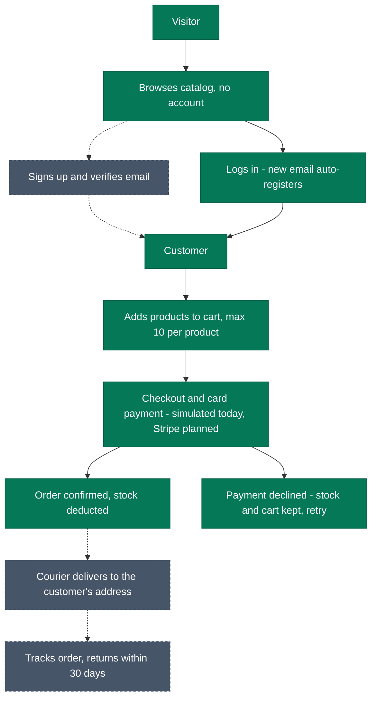
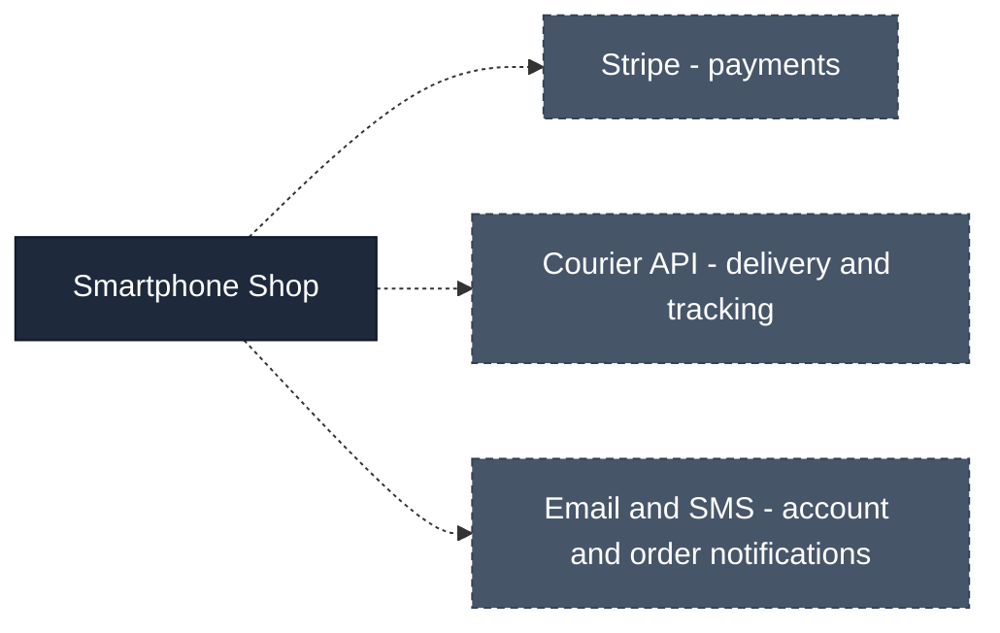

# Smartphone Shop - Project Mindmap

## Summary

Smartphone Shop is a B2C online store for smartphones and accessories. The repository has two layers:

- **Target architecture (planned):** a Next.js frontend, a NestJS REST backend ([docs/openapi.yaml](openapi.yaml)), PostgreSQL, Redis and OpenSearch, Stripe, courier and email integrations, and AWS infrastructure. It is described in [docs/context.md](context.md).
- **Current implementation:**
  - A local Next.js 16 reference app in [frontend/](../frontend/README.md) covers the core journey: catalog, login, cart, checkout with a simulated card payment, and order confirmation. It talks to PostgreSQL directly and also serves a small cookie-authenticated JSON API under `/api/v1`.
  - A Playwright + TypeScript suite in [tests/e2e/](../tests/e2e/README.md) tests it with 122 tests: 44 UI, 12 mocked-API UI and 66 REST API. It reports to the Playwright HTML report and Allure Report 3, and runs in GitHub Actions.
  - Test design documents, test data, and earlier exploratory runs with the Playwright MCP server are kept next to the app.

Related documents:

| Document | What it shows |
| --- | --- |
| [README.md](../README.md) | Project overview, quick start, implementation status, coverage and roadmap |
| [tests/e2e/framework-mindmap.md](../tests/e2e/framework-mindmap.md) | Mindmap of the whole Playwright framework: setup, layers, conventions and all 122 tests |
| [tests/e2e/tests/api/api-tests-mindmap.md](../tests/e2e/tests/api/api-tests-mindmap.md) | Mindmap of the 66 REST API tests and the 12 mocked-API UI tests |
| [tests/e2e/ALLURE.md](../tests/e2e/ALLURE.md) | How to run, read and extend the Allure reports locally and in CI |
| [tests/e2e/README.md](../tests/e2e/README.md) | Commands, environment variables, API tests, API mocks and conventions |
| [frontend/README.md](../frontend/README.md) | Reference app setup, routes, test cards and business rules as implemented |

All diagrams below are Mermaid. They render on GitHub and in the VS Code Markdown preview, with white text on dark fills so every node stays readable in light and dark themes.

## Current project (implemented)

## Target architecture (planned)

What exists today versus the plan:

| Area | Today | Planned |
| --- | --- | --- |
| Backend | Next.js server actions plus a JSON API subset under `/api/v1`, cookie session | NestJS REST API with JWT access and refresh tokens |
| Auth | Login auto-registers unknown emails | Sign up, email verification, password reset, lockout |
| Payment | Simulated cards (`4242...` paid, `4000...0002` declined) | Stripe with webhooks |
| Stock | Deducted when payment succeeds, rows locked during checkout | Reservation at checkout, released on failure or timeout |
| API tests | Playwright `api` project (66 tests) | Postman and Newman as well |
| Browsers | Chromium | Chromium, Firefox, WebKit |
| Reporting | Playwright HTML and Allure 3 | Combined Allure report for all test types |

## Main flow

Green steps work in the reference app today; gray steps are planned.

## External services

All three are planned; the reference app has no external integrations yet.

