# Playwright framework mindmap

The whole `tests/e2e` framework: how it runs, its building blocks, conventions and all 122 tests (8 tagged `@smoke`). The API tests are shown in more detail in [tests/api/api-tests-mindmap.md](tests/api/api-tests-mindmap.md).

```mermaid
%%{init: {
  "theme": "base",
  "themeVariables": {
    "primaryColor": "#1e293b", "primaryTextColor": "#ffffff",
    "git0": "#1e293b", "gitBranchLabel0": "#ffffff",
    "cScale0": "#334155", "cScaleLabel0": "#ffffff",
    "cScale1": "#1d4ed8", "cScaleLabel1": "#ffffff",
    "cScale2": "#7e22ce", "cScaleLabel2": "#ffffff",
    "cScale3": "#047857", "cScaleLabel3": "#ffffff",
    "cScale4": "#b45309", "cScaleLabel4": "#ffffff",
    "cScale5": "#be123c", "cScaleLabel5": "#ffffff",
    "cScale6": "#0e7490", "cScaleLabel6": "#ffffff",
    "cScale7": "#4338ca", "cScaleLabel7": "#ffffff"
  }
}}%%
mindmap
  root((Smartphone Shop Playwright framework))
    Setup and run
      playwright.config.ts
        Projects
          api - no browser
          chromium - UI and mocks
        webServer
          Production build on port 3100
          Ready check on login page
          Reuses server locally, never in CI
          Skipped when E2E_BASE_URL is set
        Fully parallel, 4 workers locally, 2 in CI
        CI - 2 retries, forbidOnly
        Timeouts - test 60 s, expect 10 s
        Trace, screenshot, video on failure
        Reporters - list, HTML, Allure
      global-setup.ts
        Empties allure-results
        POST api test reset
        Wipes and reseeds the database unless E2E_SKIP_RESET
        Warms up routes
      Environment
        E2E_BASE_URL
        E2E_PORT
        E2E_SKIP_RESET
        DATABASE_URL from frontend .env.local if unset
      Scripts
        test, test:smoke
        test:api, test:mocks
        test:headed, test:ui, report
        allure, allure:generate, allure:open, allure:watch
        typecheck
      Allure Report 3
        allurerc.mjs - output, history, categories
        Auto labels - layer, epic, feature, severity
        API steps with request and response attachments
        Secrets redacted
        Local history - trends and flaky detection
      GitHub Actions
        Postgres 17 service
        Frontend lint, E2E typecheck
        Chromium with system deps
        Runs both projects
        Uploads HTML report, Allure report, traces and videos on failure
    Framework layers
      Page objects
        BasePage - submitServerAction waits for the action POST
        Header
        LoginPage
        CatalogPage - search, filters, suggestions
        ProductPage
        CartPage and CartItem
        CheckoutPage
        OrderPage
      Fixtures
        Page object fixtures
        customer - fresh credentials
        signedInCustomer - logged in via the login page
        addToCart - adds via the product page
        db - worker scoped
        api - anonymous client on request
        customerApi - same client, logged in
        newCustomerApi - own cookie jars, disposed after test
        allureLabels - automatic
      Test data
        CARDS - success, declined, unsupported
        DELIVERY fees
        MAX_QUANTITY_PER_ITEM
        PRODUCTS for UI tests
        API_PRODUCTS for API tests
        CATALOG counts
        newCustomer factory
        ADDRESS, payment, checkoutBody
      DbHelper
        Read only Postgres queries
        Products, stock, orders, carts, users
      API layer
        ApiClient
        expectStatus, expectError
        Contracts with toEqual
      Mocks
        ProductsApiMock with page.route
        Records request URLs
        fakeProduct, productPage
      Utils
        formatEur
        toCents
        includedTaxCents
    Conventions
      Import test and expect from fixtures
      Selectors only inside page objects
      data-testid, role, label locators
      Unique customer per test
      Own product per stock changing test
      Web-first assertions
      Fixed wait only to prove no request is sent
      Assert UI and database
      Stable test titles, no random values
      Smoke tag - 4 UI, 4 API
    UI specs 44
      Auth 8
        First login creates account
        Wrong password error
        Returning login
        Case-insensitive email
        Field validation
        Return URL after login
        Open redirect blocked
        Logout ends session
      Catalog 12
        Lists all products
        Search by name
        Category filter
        Combined filters
        Empty state and clear filters
        SQL wildcards literal
        Unknown category ignored
        Opens product page
        Card images small files
        Product page photo
        Out of stock not addable
        Unknown product 404
      Cart 10
        Login required to add
        Add with quantity
        Same product merges
        Max 10 units
        Update recalculates totals
        Browser max validation
        Remove last item
        Remove one keeps others
        Empty cart checkout redirect
        Cart filled via API shown in UI
      Checkout 9
        Paid order deducts stock
        Delivery fees
        Declined card, retry
        Express kept after error
        Empty form errors, no order
        Invalid cards x4
          Unsupported
          Luhn failure
          Expired
          Invalid month
      Access control 5
        Anonymous redirect x3
          cart
          checkout
          order
        Other customer's order 404
        Tampered session cookie
    Mocked API UI 12
      Search suggestions
        Renders mocked data
        Debounce and query params
        Under 2 chars no request
        Empty state
        Loading state with held response
        HTTP 500, 503, 429
        Network failure
        Modified real response
        Link to product page
        HTML injection as text
    API specs 66
      Products 23
        Paging, filters, search
        422 query validation
        Details vs database, availability
        404s, categories list
      Auth 14
        Login, cookie, users me
        Wrong password 401
        422, 415, 400 bodies
        Logout, forged cookie
        401 on 6 protected endpoints
      Cart 17
        Totals, merge, update, remove, clear
        Limits, stock, validation
        Not in cart checked before stock
        Isolation between customers
      Checkout and orders 12
        Paid order, idempotency
        Declined card, delivery fees
        Empty cart 409, Idempotency-Key 400
        Validation, other customer's order, malformed id
```

